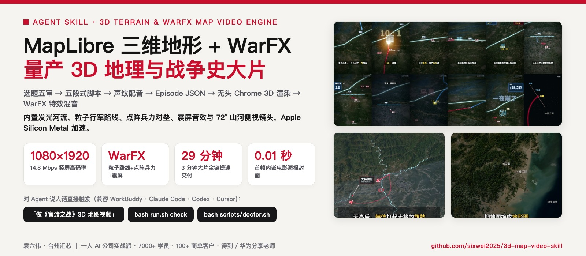
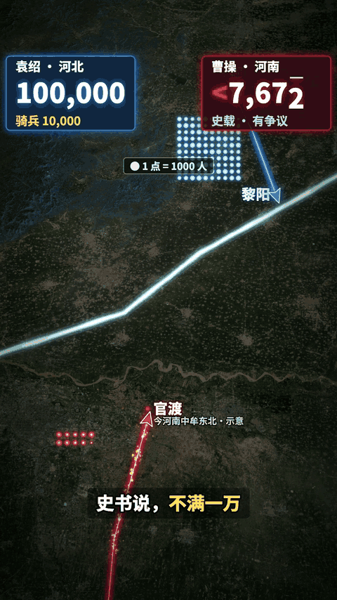
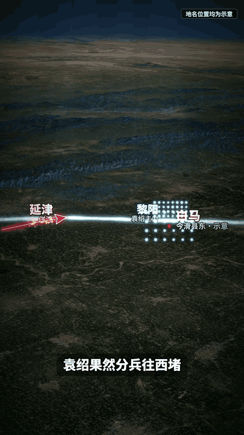
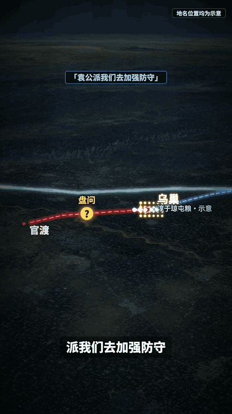
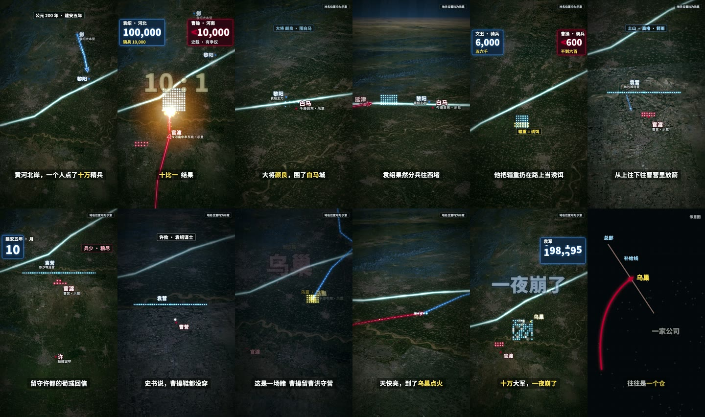
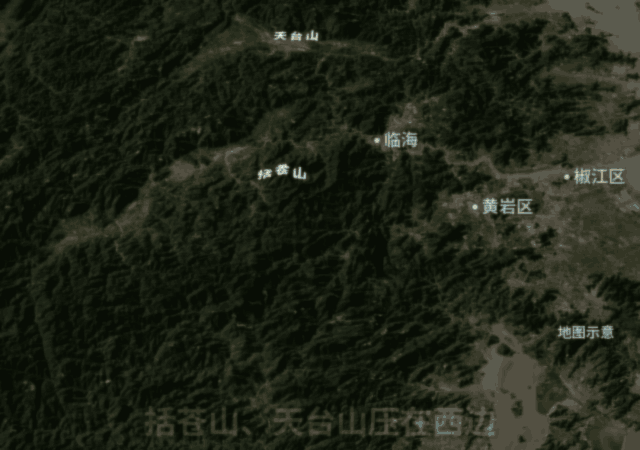
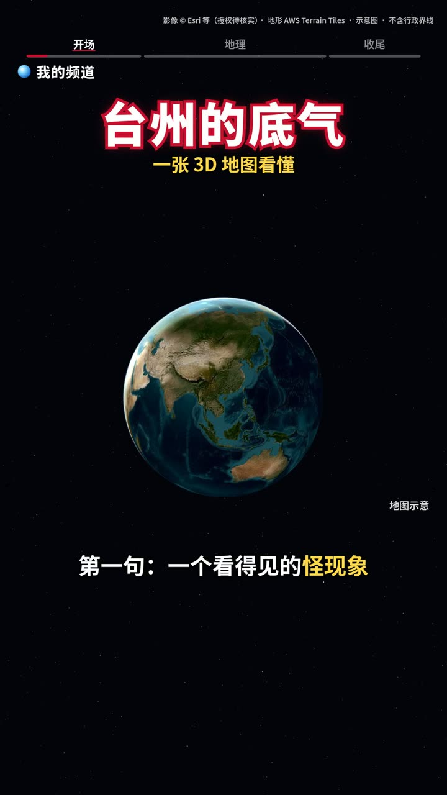
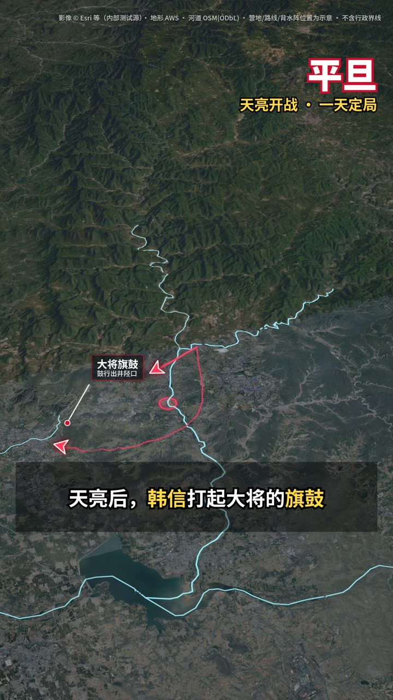
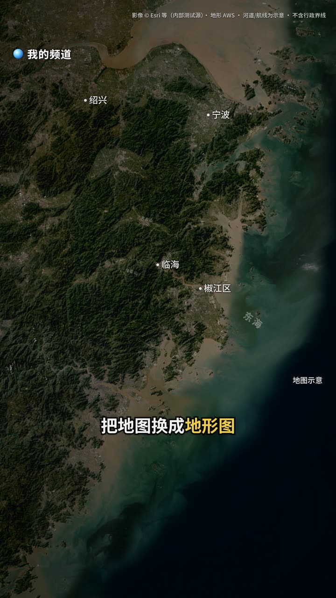

<div align="center">



# 3D 地图历史与战争短视频 Skill
### `3d-map-video-skill` · MapLibre 3D 真实地形 + WarFX 战争特效 + 29 分钟极速出片流水线

[](https://agentskills.io)
[](#三流水线架构与-warfx-战争特效引擎)
[](#四m5-极速渲染管线为什么能快-5-倍)
[](LICENSE)

> 🔴 **作者：袁六伟 · 台州汇芯**｜一人 AI 公司创业者，学员 7000+，客户 100+，得到 / 华为分享老师  
> 📮 更多 AI 工具实测与自动化实战，关注 **公众号 / 视频号：袁六伟**

**把枯燥的地名与兵力数字，变成一镜到底的 3D 地球俯冲、山脉河谷侧视巡航与火烧乌巢粒子战场。**  
支持 **城市地理科普** 与 **古代战役推演（WarFX）** 双模式：通过一份 `episode.json` 定义镜头轨迹、行军路线与口播台词，无头 Chrome + WebGL 逐帧确定性渲染 `1080×1920` 竖屏大片，配合 `lo_check.sh` 碰撞预检，从选题到交片全链路压进 **29 分钟**。

```bash
# 方式 A：通过 skills CLI 一键安装（推荐）
npx skills add sixwei2025/3d-map-video-skill

# 方式 B：克隆完整工程并安装渲染依赖
git clone https://github.com/sixwei2025/3d-map-video-skill.git
cd 3d-map-video-skill && npm install
```

[WarFX 战役动图画廊](#一warfx-战役特效与城市俯冲真实画廊) · [一条命令出片](#二一条命令极速出片) · [WarFX 引擎与五步架构](#三流水线架构与-warfx-战争特效引擎) · [29 分钟极速管线](#四m5-极速渲染管线为什么能快-5-倍) · [地图合规红线](#五地图审图与数据合规红线必读)

</div>

---

## 一、WarFX 战役特效与城市俯冲真实画廊

### 1. WarFX 战役推演实拍：《官渡之战 · 78 秒竖屏成片》

| 粒子行军箭头 + 方块点阵兵力对比 | 3D 真实山脉地形侧视巡航 | 火烧乌巢（65 粒子火场 + 震屏） |
| :---: | :---: | :---: |
|  |  |  |

| 官渡之战 · 电影级竖屏封面 | 官渡之战 · 全片 6 幕九宫格总览 |
| :---: | :---: |
|  |  |

### 2. 城市地理与萨尔浒战役多场景展示

<p align="center">
  
  &nbsp;&nbsp;&nbsp;&nbsp;
  
</p>

| 01 · 太空地球俯冲入场 | 02 · 多路进军战役路线 | 03 · 城市山脉盆地 3D 高程 | 04 · 萨尔浒之战竖屏封面 |
| :---: | :---: | :---: | :---: |
|  |  |  |  |

---

## 二、一条命令极速出片

### 1. 在 Agent 中自然语言触发

| 你对 Agent 说的话 | 自动执行的流水线动作 |
| :--- | :--- |
| `做一条「赤壁之战：曹操号称八十万大军为什么败给五万联军」的 3D 地图视频` | 选题五审 → 生成 5 段式口播 + 经纬度运镜 `episode.json` → 0.5 秒标签碰撞预检 → 渲染成片 |
| `先跑一下标签碰撞预检，别急着渲染全片` | 运行 `bash scripts/lo_check.sh episodes/guandu_war.json` 在 0.5 秒内检查文字重叠与越界 |
| `用极速模式渲染官渡之战` | 调用 `scripts/render_fast.mjs`（24fps + JPEG 直灌 FFmpeg 管道 + SFX 战场音效混音） |

### 2. 命令行标准工作流

```bash
# Step 1: 0.5 秒标签碰撞与安全区预检（不启动重型渲染，秒级排错）
bash scripts/lo_check.sh episodes/guandu_war.json

# Step 2: 逐句生成 Edge-TTS 语音并测量真实时长回写 JSON
python3 scripts/tts_generate.py episodes/guandu_war.json

# Step 3: 启动 M5 WebGL 极速渲染器（78 秒视频仅需 ~2.5 分钟）
node scripts/render_fast.mjs episodes/guandu_war.json

# Step 4: 合成冷兵器战场音效（行军鼓点/号角/刀剑碰撞/大火燃烧）与封面
python3 scripts/war_sfx_mix.py episodes/guandu_war.json
```

---

## 三、流水线架构与 WarFX 战争特效引擎

<p align="center">
  
</p>

### WarFX 六大视觉与听觉武器（`template/war_fx.js` + `scripts/war_sfx_mix.py`）

1. **方块点阵兵力对比（Troop Dot Matrix）**：用动态点亮的红/蓝方格阵列直观展示「袁绍 10 万 vs 曹操 2 万」的悬殊体量，比单纯写数字冲击力强 10 倍。
2. **双层流光粒子行军线（Particle March Route）**：底层渐变虚线轨迹 + 顶层发光粒子沿贝塞尔曲线高速奔涌，前端带方向箭头与兵种徽章。
3. **65 粒子物理火场 + 震屏（Fire & Screen Shake）**：触发「火烧乌巢/赤壁火攻」关键帧时，自动叠加 65 颗上升火星粒子、径向红光脉冲与 `±6px` 衰减震屏。
4. **地名标签碰撞躲避（Smart Label Collision）**：自动检测同屏城池、关隘、兵团旗帜的 Bounding Box，重叠时自动偏移引线角度。
5. **五段式运镜语法**：`太空俯冲 (Globe Dive)` → `高倾斜角山川巡航 (Pitch 65°)` → `双城对峙俯瞰` → `侧视河谷走廊推进` → `全局战略拉远`。
6. **程序化战场音效库（`war_sfx_mix.py`）**：按分镜时间戳自动混入低频战鼓（March Drum）、苍凉号角（War Horn）、刀剑交锋（Clash）与烈火噼啪声。

---

## 四、M5 极速渲染管线：为什么能快 5 倍？

早期版本渲染一条 75 秒视频需要 18 分钟以上，升级后的 **`render_fast.mjs` + `lo_check.sh`** 将全流程压进 **29 分钟（其中纯渲染仅需 ~2.5 分钟）**：

| 优化维度 | 传统截屏方案（慢） | 本仓库极速方案（快 5x） |
| :--- | :--- | :--- |
| **排版排错** | 渲染完 15 分钟发现两个地名叠在一起，推倒重来 | 先跑 `lo_check.sh`，**0.5 秒**算完所有帧标签坐标碰撞 |
| **帧传输协议** | `page.screenshot({type:'png'})` 落盘几千张小文件 | `canvas.toDataURL('image/jpeg', 0.92)` 内存管道直灌 `ffmpeg stdin` |
| **瓦片等待策略** | 每帧死等 `sleep(200ms)` | 预热相机轨迹瓦片缓存 + WebGL `idle` 信号精准触发 |
| **帧率与编码** | 30fps PNG 无损序列 | 24fps 电影感帧率 + Hardware VideoToolbox / `libx264 -preset fast` |

---

## 五、地图审图与数据合规红线（必读）

在涉华历史与地理短视频发布中，**地图合规是第一生命线**：

1. **严禁使用未经审图的境外开源边界数据描绘现代中国国界**：涉及现代中国全图、省界、藏南、阿克赛钦、台湾岛、钓鱼岛、南海诸岛及十段线时，**必须切换为自然资源部标准地图服务（天地图 `tianditu.gov.cn`）底图并标注审图号**。
2. **古代战役纯地形模式**：在讲官渡、赤壁、萨尔浒等古代局部战役时，默认开启 **纯卫星地形高程无现代国界模式（Pure DEM Terrain）**，只展示山脉、河流与古地名标签，不叠加任何现代行政边界图层。

---

## 关于作者与开源生态

**袁六伟 · 台州汇芯**：一人 AI 公司创业者，学员 7000+，服务商单客户 100+，覆盖近 20 个行业，得到 / 华为分享老师。AI 变现实战派，自己跑通才拿出来教。

- 公众号：**袁六伟**（微信搜一搜关注，看更多 AI 工具实测与一人公司实战）
- 视频号：**袁六伟**

这个项目免费开源。如果它帮你的产线省下了每天反复返工的时间，欢迎在右上角点个 ⭐ **Star**，也欢迎转发给身边做内容或一人公司的朋友。

### 同系列开源 Skill 矩阵（袁六伟 · 台州汇芯）

| 仓库 | 领域 | 核心能力 |
| :--- | :--- | :--- |
| [**workbuddy-wechat-autopilot**](https://github.com/sixwei2025/workbuddy-wechat-autopilot) | 公众号全链路 | 九步全自动总控：选题→写稿→真实截图→6套封面→6套排版→三重自动质检→草稿箱 |
| [**wechat-cover-skill**](https://github.com/sixwei2025/wechat-cover-skill) | 公众号视觉 | 封面渲染引擎（6套高客单价杂志风 + 黑红金 v2b + 防压脸自动校验） |
| [**gzh-million-layout-skill**](https://github.com/sixwei2025/gzh-million-layout-skill) | 公众号排版 | 汇芯红 `#C8102E` 六套 100% 内联 CSS 骨架 + 零乱码检查 + 配图皮肤 |
| [**ai-tool-review-wechat-skill**](https://github.com/sixwei2025/ai-tool-review-wechat-skill) | 公众号评测 | AI 工具真跑评测工作流（2.0 全自动压测 + 去碎句语感质检 + 六套骨架装配） |
| [**hit-title-expert-skill**](https://github.com/sixwei2025/hit-title-expert-skill) | 爆款标题 | 一次直出 10 条 14–22 字高浓缩狠标题（5大公式 × 5类钩子词） |
| [**auto-tutorial-skill**](https://github.com/sixwei2025/auto-tutorial-skill) | 短视频工程 | 链接/网页/真机截图 → 3:4 封面 + 1.5x 配音 + 红框标注教程视频 |
| [**talking-head-video-skill**](https://github.com/sixwei2025/talking-head-video-skill) | 短视频工程 | 1080×1920 竖屏真人口播短视频（ASR 错字校对 + 逐字卡拉OK字幕 + 6项QC） |
| [**3d-map-video-skill**](https://github.com/sixwei2025/3d-map-video-skill) | 短视频工程 | MapLibre 3D 地形 + WarFX 战争特效（粒子行军/点阵兵力/震屏混音） |
| [**psych-kepu-video-skill**](https://github.com/sixwei2025/psych-kepu-video-skill) | 短视频工程 | Remotion + JSON 驱动的 15–30s 深色扁平动画心理科普短视频 |
| [**dark-infographic-video-skill**](https://github.com/sixwei2025/dark-infographic-video-skill) | 短视频工程 | 纯 Python + FFmpeg 暗黑流光数据可视化科普片（含 v2 手机外放配乐） |
| [**local-video-hub**](https://github.com/sixwei2025/local-video-hub) | AI 团队基建 | 视频版本地 Obsidian：多 AI 员工统一交片、撞题查重与四态流转云台 |
| [**yuanliuwei-ai-skills**](https://github.com/sixwei2025/yuanliuwei-ai-skills) | 一人公司方法 | PACT 72h 需求验证模型与一人 AI 公司 10 大业务决策模块 |
| [**book-skill**](https://github.com/sixwei2025/book-skill) | 知识工程 | 上传任意书籍 PDF → 自动提炼方法论生成 `.skill` + 公众号导流文案 |
| [**huangdi-skill**](https://github.com/sixwei2025/huangdi-skill) | 认知操作系统 | 中国历史八大皇帝（秦始皇/汉武帝/唐太宗等）一手史料认知框架蒸馏 |
| [**sunrise-tracker**](https://github.com/sixwei2025/sunrise-tracker) | 选题雷达 | 小红书 AI 赛道 10 倍异常流量「低粉爆文」每日早 7 点监测推送 |
