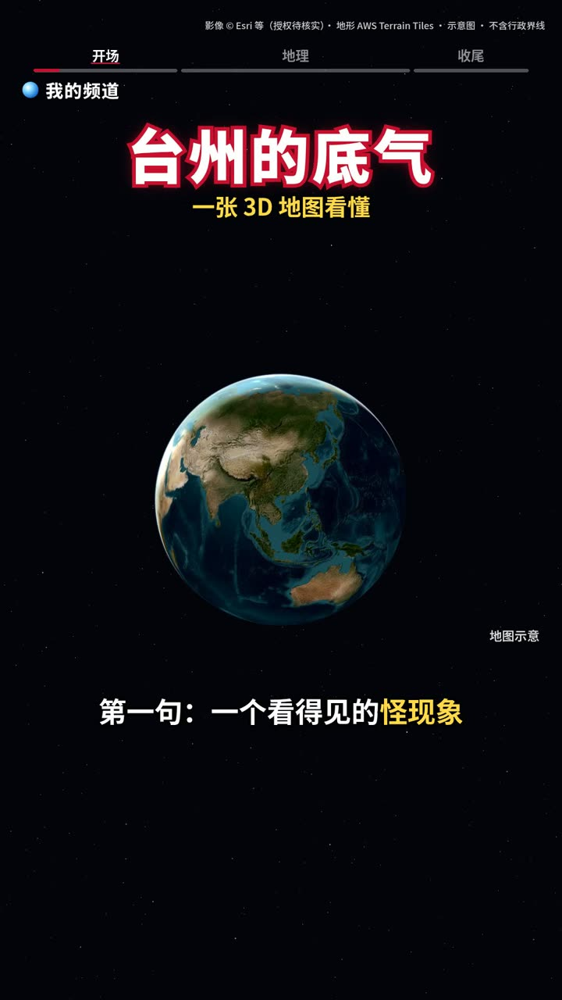
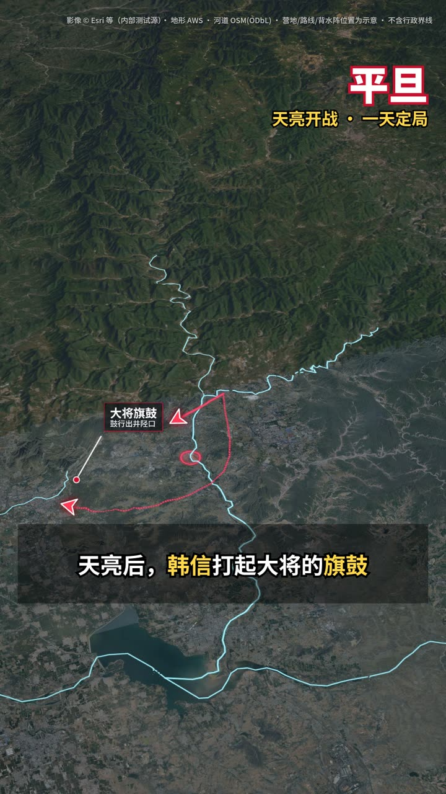
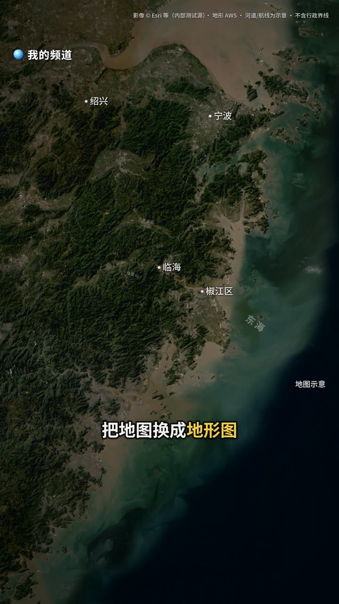
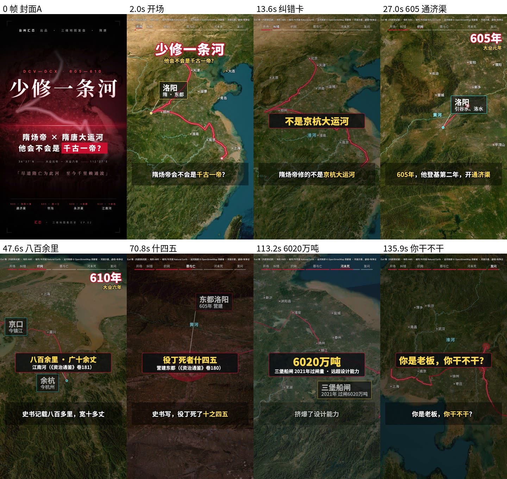
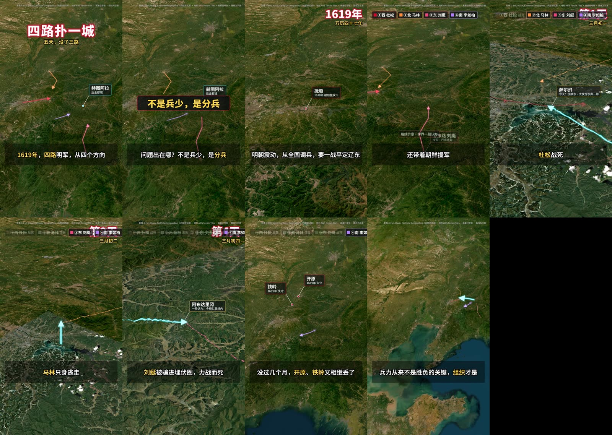

# 3D 地图短视频 Skill（3d-map-video）

> 爆火的 3D 地图视频，WorkBuddy / Codex / Claude Code 轻松复刻。一个符合 [Agent Skills](https://agentskills.io/specification) 规范的 skill：让 agent 从选题、脚本到 1080×1920 成片一条龙做出「3D 地图讲城市/历史/战争」竖屏口播短视频。

**English**: An Agent Skill that turns a script into a 1080×1920 vertical "3D map explainer" short video — MapLibre 3D terrain rendered frame-by-frame in headless Chrome, with neon routes, labels, number cards, a full-length CC0 music bed and ffmpeg delivery at ~14 Mbps. Works with any agent that loads `SKILL.md` (Claude Code, Codex, WorkBuddy, …).

## 效果展示
| | | |
|---|---|---|
|  |  |  |
| **地球俯冲开场**：片名 + 顶部章节进度条 + 频道水印 | **行军路线**：霓虹线一笔画出 + 地名牌 + 无框字幕（井陉之战） | **城市地形**：压灰卫星底图 + 城市注记（台州） |
|  |  | |
| **封面大字卡**（电影海报风，作为成片首帧） | **封面大字卡**：同一模板只换数据和文案 | |

| 全片抽帧 |
|---|
|  |
| 大运河：封面 → 开场 → 纠错卡 → 年份卡 → 数字卡 → 金句收尾 |
|  |
| 萨尔浒之战：四路箭头、年份卡、侧视山地、地名牌 |

### 动态演示 GIF
- 战争史：`assets/showcase/demo-war.gif`（待补）
- 城市：`assets/showcase/demo-city.gif`（待补）

## 安装
任选一种：
```bash
# 1) skills CLI
npx skills add sixwei2025/3d-map-video-skill
# 2) 手动：把 skills/3d-map-video 复制到你的 agent 的 skills 目录
cp -r skills/3d-map-video ~/.claude/skills/        # Claude Code
cp -r skills/3d-map-video ~/.codex/skills/         # Codex（以你的版本文档为准）
# WorkBuddy 等：放到其 skills 目录即可
```
然后对 agent 说：「用 3d-map-video skill，给 <城市/战役> 做一条 3D 地图短视频」。

## 依赖
Node.js ≥18、Google Chrome/Chromium、ffmpeg（含 libx264）、Python 3 + numpy + Pillow。MapLibre GL JS 与 Noto Sans SC 字体已内置。Apple Silicon Mac 走 Metal 最快；无 GPU 的 Linux 可跑但慢。

## 快速开始
```bash
cd skills/3d-map-video
npm install && bash scripts/fetch_music.sh && pip3 install numpy pillow
bash scripts/doctor.sh
ID=demo_city MODE=sample SAMPLE="0-30" PAR=1 bash scripts/run_all.sh   # 1 秒小样 → out/demo_city/
```
完整流程（选题五审 → 五段式脚本 → 配音 → episode JSON → 一条命令全链 → 自检 → 交付）见 [`skills/3d-map-video/SKILL.md`](skills/3d-map-video/SKILL.md)。

## 目录
```
skills/3d-map-video/
  SKILL.md        主流程（7 步）
  engine/         渲染/编码/混音/封面/实拍层引擎
  scripts/        run_all.sh 一条命令全链 · selfcheck.py · doctor.sh · fetch_music.sh
  templates/      episode JSON、脚本、出处表、发布包、复盘模板
  references/     快速开始、已知坑、选题五审+五段式、爆款标题六招、对标拆解
  examples/       台州（城市）、井陉之战（战争史）脚本+出处+时间轴；样张
  episodes/       可直接编译的示例
  assets/music/   配乐授权登记（音频用 fetch_music.sh 下载）
assets/showcase/  README 效果图
```

## 素材与许可提醒
- **卫星影像**默认 Esri World Imagery 免登录端点，**商用授权【待核实】**，正式发布请换有授权的影像源（episode `imagery` 字段可改）。
- **地形** AWS Terrain Tiles（Terrarium），署名要求【待核实】；河流 Natural Earth（公有领域）、OSM（ODbL，需署名）。
- **国界/省界**：内置 DataV 数据仅供调试，许可与完整性【待核实】；模板默认不画国界省界，涉及国界请按《地图管理条例》使用标准地图或送审。
- **配乐**：War Theme (ver 2) / Spring Spring、Determined Pursuit / Emma_MA，均 CC0 1.0（OpenGameArt）。
- **字体** Noto Sans SC（SIL OFL 1.1）；**MapLibre GL JS**（BSD-3-Clause）。
- 实拍素材只用公有领域/CC/自有素材，来源逐条写进发布包。本仓库不含任何成片视频与配音。

## 致谢
- [maplibre/maplibre-gl-js](https://github.com/maplibre/maplibre-gl-js)：三维地图渲染引擎（内置于 `engine/vendor/`）
- [puppeteer/puppeteer](https://github.com/puppeteer/puppeteer)：`puppeteer-core` 驱动无头 Chrome 逐帧截图
- [anthropics/skills](https://github.com/anthropics/skills) 与 [Agent Skills 规范](https://agentskills.io/specification)：skill 目录与 SKILL.md 格式
- [fontsource/fontsource](https://github.com/fontsource/fontsource)：Noto Sans SC 网页字体包
- [tilezen/joerd](https://github.com/tilezen/joerd)：AWS Terrain Tiles（Terrarium 地形）

## License
代码与文档：MIT（见 LICENSE）。第三方组件与数据遵循各自许可。
